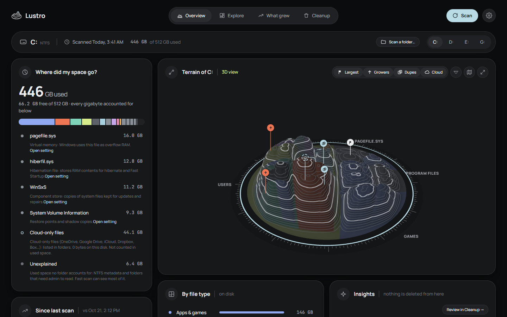
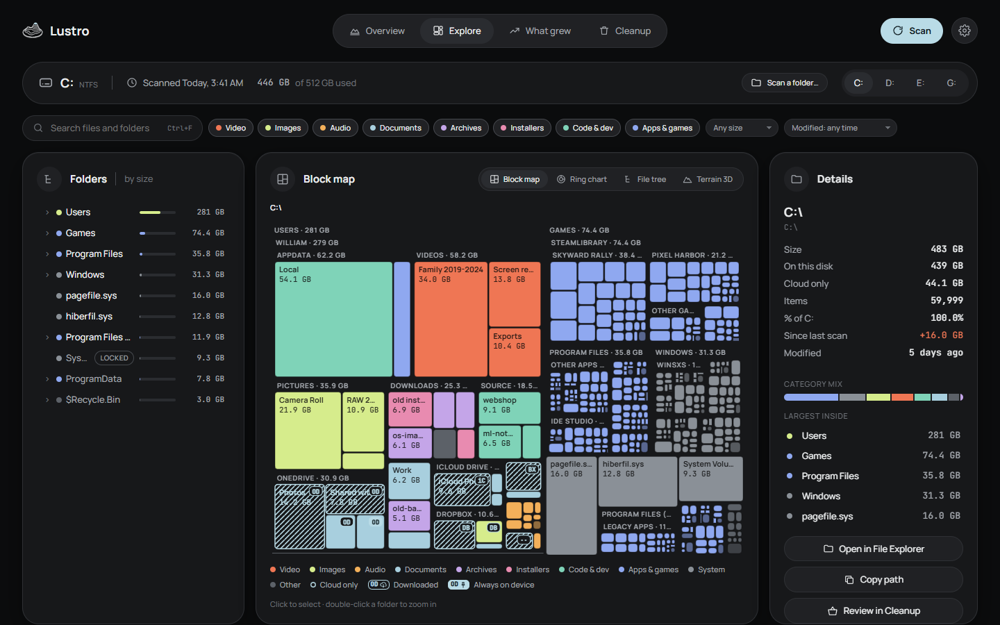
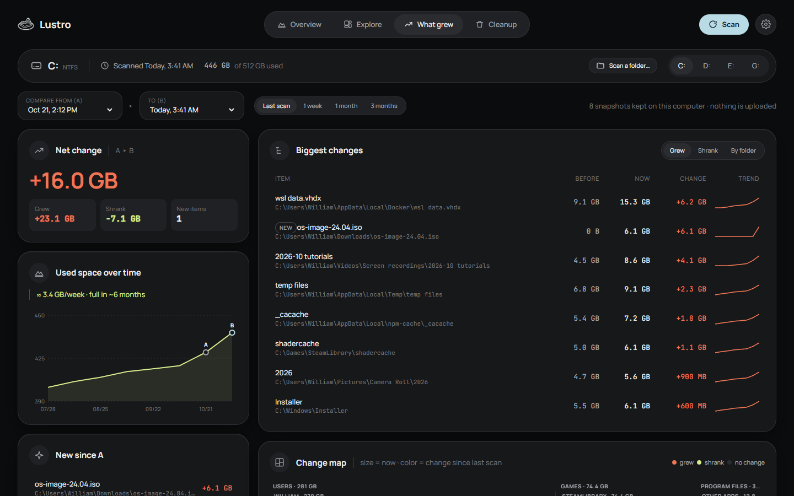
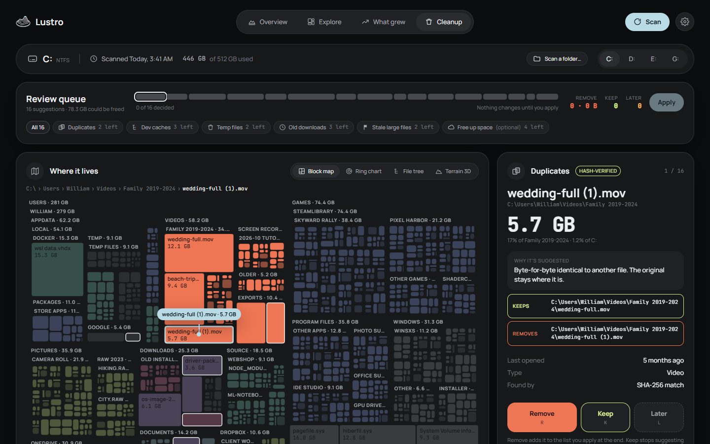

# Lustro

**See where your disk space went, and get it back safely.**

Lustro is a free, open-source disk-usage explorer for Windows. It scans a drive or a folder, shows
you what is taking up space as a block map, a ring chart, a folder tree or a 3D terrain, tells you
what grew since last time, and helps you clean up through a review queue where everything goes to
the Recycle Bin and can be undone.

It works offline. No account, no telemetry, no ads.

> **Status: early preview (0.1).** Lustro works, but it is new. Expect rough edges, and please [report anything odd](https://github.com/silent-diffusion/lustro/issues).
> Windows only for now; macOS and Linux are planned.



## Download for Windows

### [⬇ Download Lustro for Windows](https://github.com/silent-diffusion/lustro/releases/latest)

On the release page, click **`Lustro-Setup-x.y.z.exe`** (the numbers are the version). It is a
single file of about 6 MB. Windows 10 and 11 (64-bit) are supported.

### How to install

1. Open the file you downloaded (it is usually in your **Downloads** folder).
2. Windows may show a blue box saying **"Windows protected your PC"**. This appears because Lustro
   is new and its installer isn't code-signed yet, not because something is wrong. Click
   **More info**, then **Run anyway**.
3. Click **Install**. Lustro installs just for you, so it doesn't ask for an administrator
   password, and it opens when it's done.
4. You'll find Lustro in the Start menu from now on.

**Updates install themselves.** Lustro checks for a new version when it starts and once a day,
downloads it in the background and installs it the next time you open the app. Every update is
signed, and Lustro refuses any update whose signature doesn't match. You can turn this off in
**Settings → Updates**.

**Uninstall** from Windows **Settings → Apps → Installed apps → Lustro → Uninstall**.

<details>
<summary>Portable version and checksums</summary>

- **Portable:** each release also has `Lustro-x.y.z-portable-windows-x64.zip`. Unzip it anywhere
  and run `lustro.exe`. Keep the files in the zip together. It needs the Microsoft Edge WebView2
  runtime, which Windows 11 already has.
  **The portable version never updates itself and makes no network requests at all.** To update
  it, download the new zip from the
  [Releases page](https://github.com/silent-diffusion/lustro/releases).
- **Checksums:** `SHA256SUMS.txt` on each release lists the SHA-256 of every file. In PowerShell:
  `Get-FileHash .\Lustro-Setup-x.y.z.exe` and compare.
</details>

## What it does

| | |
|---|---|
|  |  |
| **Explore** the drive as a block map, ring chart, file tree or 3D terrain, with search and filters. | **What grew** compares each scan with the last one and shows the trend. |



**Cleanup** is a review queue: duplicates (verified byte for byte), dev caches, temp files, old
downloads and stale large files. You decide on each item; nothing changes until you click Apply,
everything goes to the Recycle Bin, and Undo puts it back.

Also:

- **"Where did my space go?"** explains the hidden parts: page file, hibernation file, restore
  points, the component store and space nobody can account for.
- **Cloud files** from any provider (OneDrive, Dropbox, iCloud, Google Drive, Box…) are shown as
  cloud-only, downloaded or always kept on the device. Lustro never downloads them.
- **Fast scan** reads the drive's index (NTFS) for a much quicker scan. It's optional and asks for
  administrator permission each time; a small separate helper does the reading, so the app itself
  never runs as administrator.

_Screenshots show made-up sample data, not a real computer._

## Privacy

- **Offline.** The only network request Lustro ever makes is the update check: an HTTPS download
  of a small file from this project's GitHub Releases. It sends no identifiers. Turn off
  automatic updates and Lustro makes no network requests at all.
- **No telemetry**, analytics, crash uploads or ads. Nothing is uploaded, ever.
- **Read-only scanning.** Scanning never changes, opens for writing or downloads a file.
- **Your data stays on your computer.** Scan history (which contains file names) is stored in your
  user profile and can be cleared in one click from Settings.
- **Safe cleanup.** Only to the Recycle Bin, with a review step and undo. System folders are
  protected and can't be removed from the protected list.

## Build from source

You need [Rust](https://rustup.rs) (stable, 1.85 or newer), [Node.js](https://nodejs.org) 22 or
newer, and on Windows the Microsoft C++ Build Tools. On Linux, also the
[Tauri system packages](https://v2.tauri.app/start/prerequisites/).

```bash
git clone https://github.com/silent-diffusion/lustro.git
cd lustro
cd app/ui && npm ci && cd ../..
cd app/src-tauri && ../ui/node_modules/.bin/tauri dev
```

`npm ci` also installs the Tauri CLI, at the exact version pinned in `app/ui/package.json`.

Run the checks the CI runs:

```bash
cargo fmt --all --check
cargo clippy --workspace --all-targets --all-features -- -D warnings
cargo clippy --workspace --all-targets -- -D warnings
cargo test --workspace --all-features
cargo test --workspace
cd app/ui && npm run check && npm test
```

Build the Windows installer (writes `target/release/bundle/nsis/Lustro-Setup-x.y.z.exe`):

```bash
powershell -File app/src-tauri/scripts/build-installer.ps1
```

The UI also runs in a plain browser against a built-in mock backend with fake data:
`cd app/ui && npm run dev`.

## Project layout

| Path | What |
|---|---|
| `crates/lustro-core` | Platform-neutral model: tree, sizes, categories, snapshots, diff, insights, cleanup plans |
| `crates/lustro-scan` | Scanners: parallel walker (all OS) and the Windows fast path |
| `crates/lustro-scan-helper` | The small elevated helper for the fast scan |
| `crates/lustro-cloud` | Cloud-file detection per OS |
| `crates/lustro-platform` | Recycle Bin, reveal in Explorer, protected paths, system-space explainer |
| `app/src-tauri` | The desktop app (Tauri 2) |
| `app/ui` | The interface (Svelte 5 + TypeScript) |

## Contributing and security

- [CONTRIBUTING.md](CONTRIBUTING.md) explains how to propose changes.
- Found a security problem? Please report it privately, as described in [SECURITY.md](SECURITY.md).
- [CHANGELOG.md](CHANGELOG.md) lists what changed in each version.

## License

[MIT](LICENSE). Bundled fonts and libraries keep their own licenses; see
[THIRD-PARTY-NOTICES.md](THIRD-PARTY-NOTICES.md).
